# Wavebreak

A 3D survivors-like made in **Godot 4.7.1 (.NET / C#)**. You wash up on a
shore with one weapon. Then you run, jump, dash, slide and slam through
waves of cute monsters, build up weapons, items and tomes, beat a boss on
each of three maps, and hold the line through the Final Swarm.

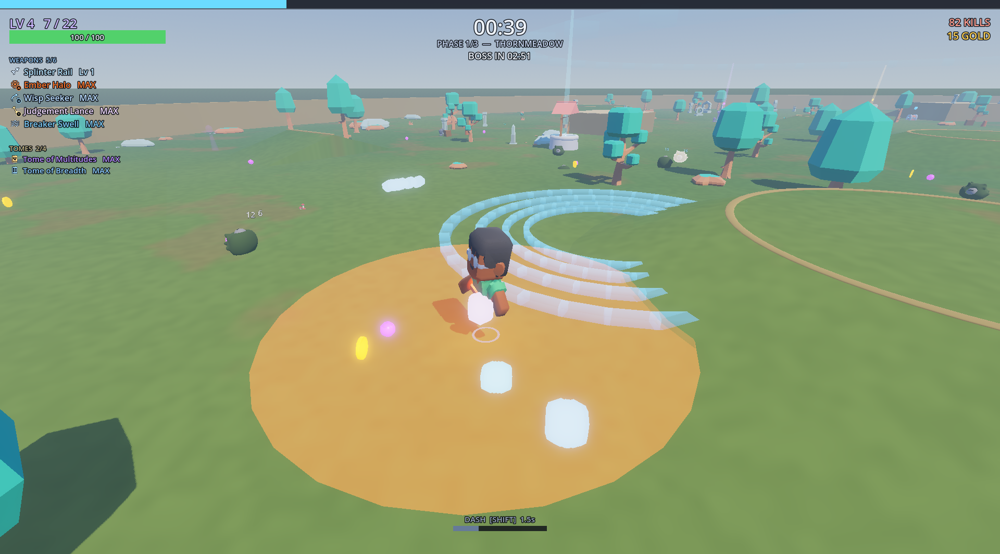

## Download and install

Get the latest build from [Releases](https://github.com/mPhpMaster/wavebreak-godot-game/releases).

- **Installer:** `Wavebreak-Setup-<version>.exe`
  - Installs for your user by default and adds a Start-menu shortcut, plus an optional desktop one.
  - Removable from *Add or remove programs*.
  - It is unsigned, so Windows SmartScreen asks once: *More info → Run anyway*.
- **Portable:** `Wavebreak-<version>-windows.zip`. Unzip anywhere and run `Wavebreak.exe`.

Saves, settings and unlocks live in `%APPDATA%\Godot\app_userdata\Wavebreak`.

## What's in it

| | |
|---|---|
| Maps | 6: Thornmeadow, Rimeglass Plateau, Cinder Reach, Gravemoor, Saltglass Shallows and Stormwatch Harbour (the biggest: an old town, cliffs, a lighthouse, docks and a coral canyon you cannot see across). Each has its own enemies, hazards, boss and music; a run is 3 maps on Normal and Hard, 4 on Nightmare and Tempest, 5 from Abyss up |
| Weapons / items / tomes | 33 / 98 / 26, with elements, status effects, megacrits and upgrade rarities. Three are signature weapons that only their hero can hold |
| Perks | 15 levelled rules picked like tomes (and sometimes found in chests): chain lightning every Nth hit, shield bubbles from elites, a chilling dash wake, stomps, crits that heal, orbiting XP motes, gold-fuelled damage, a refused lethal blow, a chest-finding beacon, a knock-back pulse, armour for standing still, speed-fuelled attack speed, a cornered damage boost, and two team perks (Crew Beacon buffs nearby allies; Lifeline speeds up the revives you give). Perks share the tome slots |
| Enemies | 53, including phase bosses with move sets |
| Characters | 24 with passives, 151 skins, 22 hats. The heroes trio each bring a signature weapon: Sunny the Lookout (Spyglass Glint, a precise beam at whatever you look at), Biscuit the Sea Dog (Mooring Anchor, a ring that holds a crowd until it is hauled in) and Flick the Kite Fox (Skimmer Kite, a kite you steer by running) |
| Quests | 327 (18 secret), which unlock characters, weapons, items, skins and Pearls |
| Meta | Pearls, the Pearl Shop, difficulty tiers, 12 global modifiers, 66 map challenges, the Toggler, leaderboard |
| Run events | Charge, challenge, statue, greed, balance and wishing-well shrines; microwave; pots; chests |
| Rest stop | Between maps: a beach island with the merchant, a campfire that heals to full and a microwave. No enemies, the clock is paused; step into the CONTINUE portal when ready. A boss portal closes after 90 s on Normal (30 s on Endless Tide) and then pulls you through |
| Level-up | Three cards with icons (a perk card shows what the level adds and the total); reroll (R), banish (B) and skip (X); optional compact hand that keeps the game running, and auto-pick by a rule (Settings > Gameplay) |
| Music | 21 procedurally composed tracks; the Boombox lets you play, pin or shuffle them |
| Co-op | Online, 2-4 players with Steam friends: lobbies, invites, no ports (see [Co-op](#co-op-2-4-players)) |
| Languages | English and Arabic (full right-to-left layout) |
| Settings | Full graphics page (presets, display, scaling/FSR, AA, shadows, effects, FOV, shake, UI scale, weapon-effect opacity, FPS counter), audio, key bindings |

## Co-op (2-4 players)

Co-op runs through **Steam**: you play with your Steam friends, and nobody
types an address or forwards a port. Everyone needs the Steam client running
and signed in. Steam is only started when you open the CO-OP page;
single-player never touches it.

Title screen → **CO-OP**.

1. **Host:** pick your character and skin with the arrows, choose
   **Lobby: Public** or **Invite only**, and press **HOST (Steam)**. This
   opens a lobby for up to 4 players. A public lobby is listed for everyone
   under **BROWSE PUBLIC GAMES**; an invite-only lobby is for the friends you
   invite. The game remembers your last choice.
2. **Invite:** press **INVITE FRIENDS** to open the Steam overlay's invite
   dialog. If no Steam window appears, open your Steam friends list,
   right-click a friend and choose **Invite to Lobby**.
3. **Join:** a friend who already has Wavebreak open on the CO-OP page can do
   any of these:
   - accept the invite in Steam;
   - right-click you in their Steam friends list and choose **Join Game**;
   - press **JOIN** next to your name under **FRIENDS IN A GAME**;
   - for a public game: press **JOIN** on its row under **BROWSE PUBLIC
     GAMES** (host, players x/4, difficulty, and the map it is on or "In the
     lobby"). No invite needed.

   Then they press **READY**.
4. The lobby lists everyone with their Steam picture, character, skin and
   ready state. When all are ready, the host presses **START**.

**Things to know.**

- Steam shows the game as **"Spacewar"**. Until Wavebreak has its own Steam
  App ID it uses Valve's free test app (480), which every Steam account can
  use. Your friends see "Playing Spacewar", and invites say Spacewar.
- Have Wavebreak open on the CO-OP page before accepting an invite. If you
  accept while the game is closed, Steam tries to start the real Spacewar
  instead. Once Wavebreak has its own App ID, invites will start Wavebreak.
- If Steam is not running, the CO-OP page says **"Steam must be running to
  play co-op"**. Start Steam, sign in, then press **RETRY**.
- Connections go through Valve's relay network. That works behind any router,
  and players never see each other's IP addresses.

**How it plays.**

- Everyone keeps their own character, weapons, level-ups, tomes and items.
- Experience is shared: every orb anyone picks up fills everyone's bar.
  Gold and med-packs go to whoever picks them up.
- Chests are shared. The first player to open one gets it, and pays with
  their own gold.
- Shrines, the microwave and pots are each player's own; the merchant is at
  the rest stop.
- After each boss the whole team goes to the rest stop together; a downed
  player arrives revived. Everyone shops with their own gold. The next map
  starts when everyone stands in the CONTINUE portal (the count is on
  screen), or 30 seconds after the first player stepped in.
- **Swap meet:** the rest stop has a beaver's stall (co-op only). Press E
  there, pick a teammate, and once they accept, a trade window opens on both
  screens. Each of you puts up gold, items (one copy per click, the whole
  stack with a right-click or Shift-click) and whole tomes with their level.
  Both press READY, then both CONFIRM; any change to either offer clears
  both READY flags, so nothing can be switched at the last second. Offers
  your teammate could not hold (a full stack, a tome they already have, no
  free tome slot) are greyed out with the reason. Weapons are not traded.
  Leaving the room (or its 30 s countdown running out) cancels an open trade
  and nothing changes hands.
- A level-up or the pause menu does not stop the game for the others. Your
- A level-up does not stop anyone, you included: a compact hand docks at the
  bottom of the screen and you keep walking, jumping and dashing while you
  pick with 1 / 2 / 3 or a click. The pause menu does not stop the game for
  the others; your character stands still while it is open, and you cannot
  be hurt for the first 8 seconds.
- In the lobby every player stands on the beach in their character, skin and
  hat, with their name and READY state over their head. The host picks the
  difficulty for everyone; the others see it but cannot change it.
- At 0 health you go **down**. A teammate who stands next to you for 4
  seconds revives you with 40% health. The run ends when everyone is down.
- Enemies chase the nearest player who is still up. The camera follows you.
- Every teammate has a name tag in their colour with a health bar, readable
  through walls; an arrow on the screen edge points to anyone off-screen.
  A downed teammate sends up a tall beam of light, shows a red SOS on the
  minimap, and a line on screen tells you to go and revive them.
- **Ping** (G or middle mouse) marks the spot you look at for everyone:
  "Enemy here", "Chest", "Shrine", "Go here", or "Help!" when you ping
  yourself or are down. Pings last 6 seconds, 3 per 5 seconds.
- Whoever lands the killing blow on a boss is named in a banner. Hold **Y**
  for the scoreboard (kills, boss kills, downs, revives, damage dealt and
  taken, level, gold); it is also on the results screen.
- If the host leaves, the run goes on: another player becomes the host
  (a message says who) after a hitch of a second or two, with every enemy,
  orb, chest, the map and the clock as they were. If that is ever impossible
  (the new host cannot be reached), the run ends on the results screen with
  everything earned kept. If someone else leaves, their character is removed
  and the run goes on.
- You can join a run in progress, up to 4 players: anyone in a public game,
  invited friends in an invite-only one. You arrive next to the host at the
  team's average level, with your cards picked by your auto-pick rule
  (Settings > Gameplay). Co-op always uses the Classic route, with no
  challenges. The host's difficulty applies to everyone.

| | |
|---|---|
| 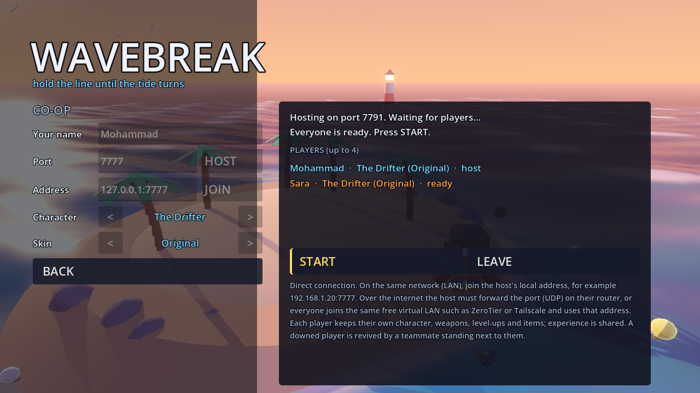 | 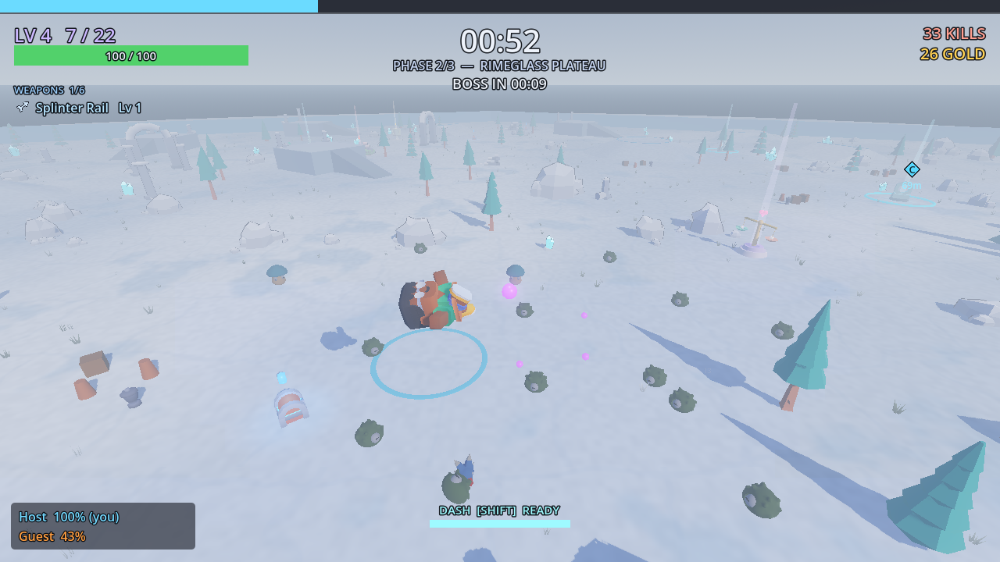 |
| Lobby: players, characters, skins, ready | Two players in a run, name tags and team panel |
| 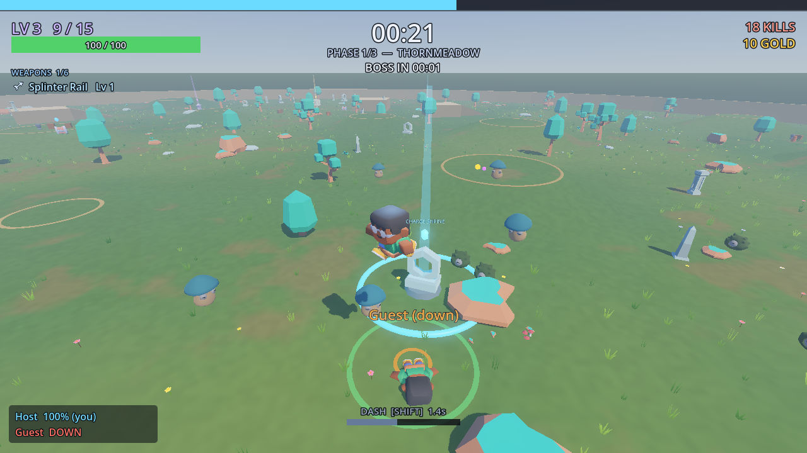 | 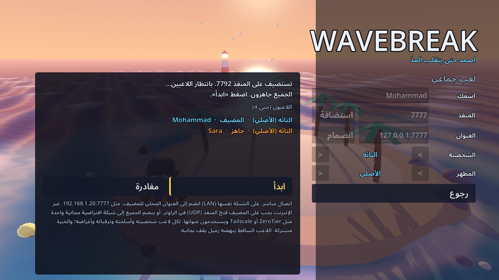 |
| A downed teammate and their revive ring | Arabic: co-op lobby |

## Screenshots

| | |
|---|---|
| 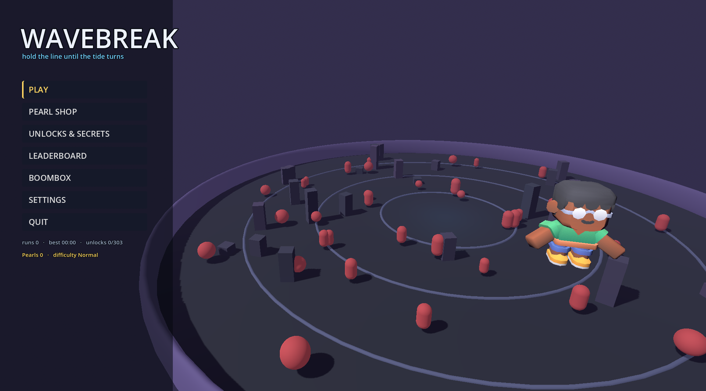 | 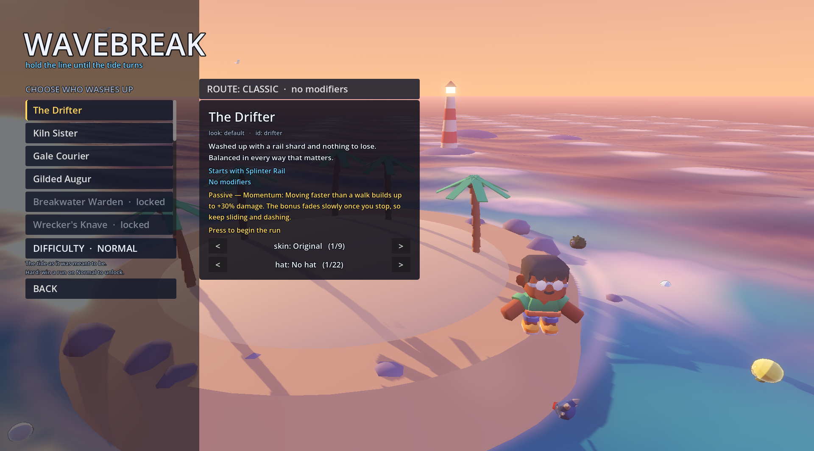 |
| Title screen | Character select: skins, hats, route, difficulty |
| 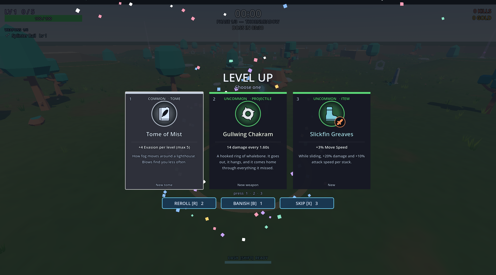 | 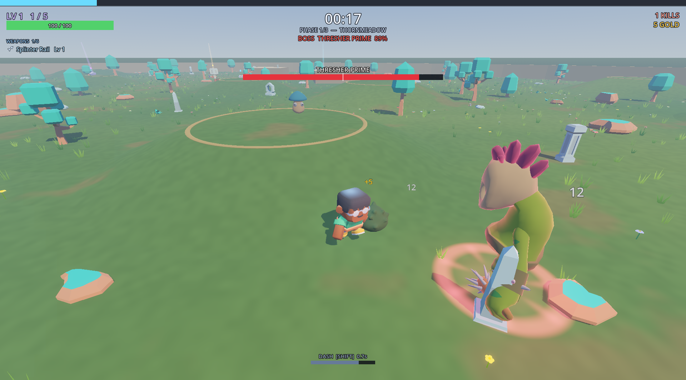 |
| Level-up cards with reroll / banish / skip | Phase boss |
| 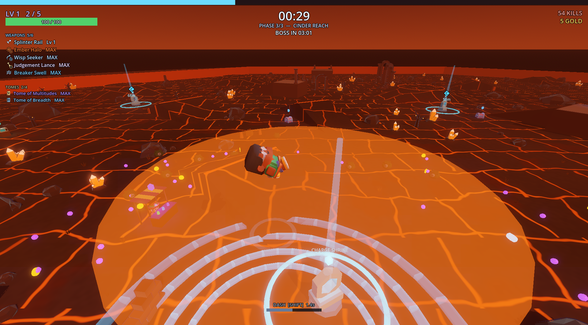 | 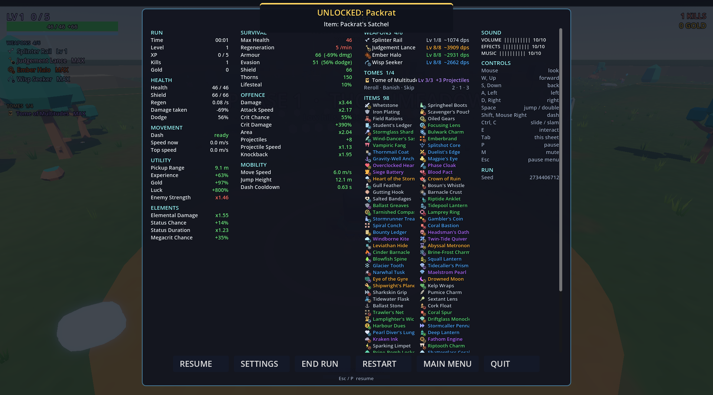 |
| Cinder Reach, a later map | Pause menu and character sheet (scrolls for big builds) |
| 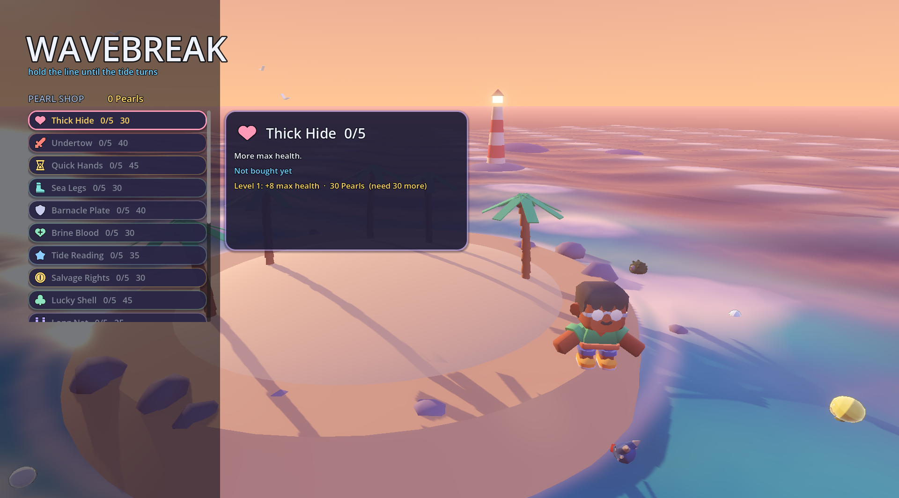 | 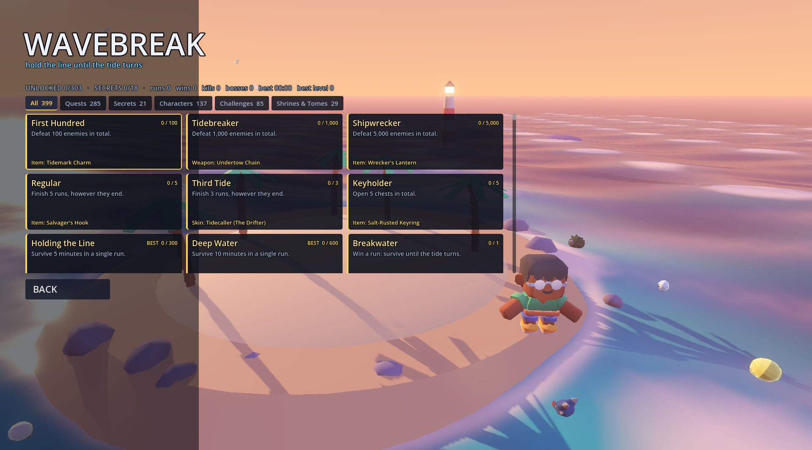 |
| Pearl Shop | Unlocks and secrets |
| 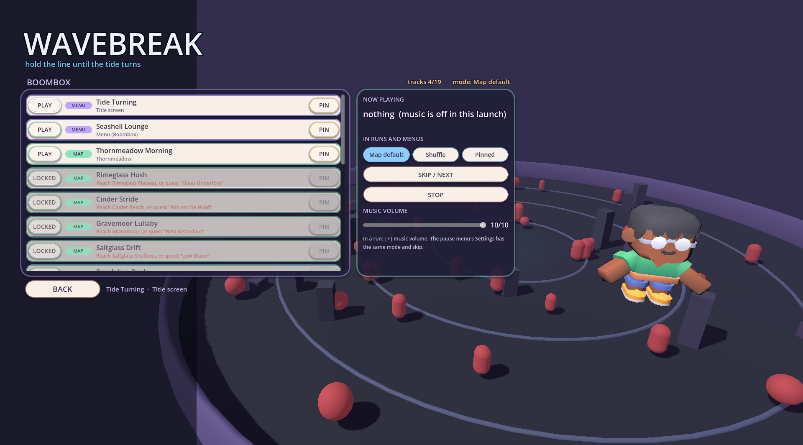 | 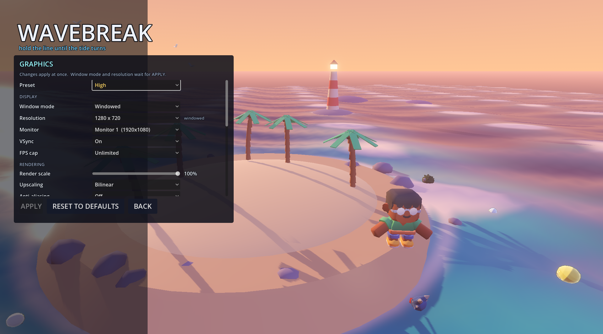 |
| Boombox | Graphics settings |
| 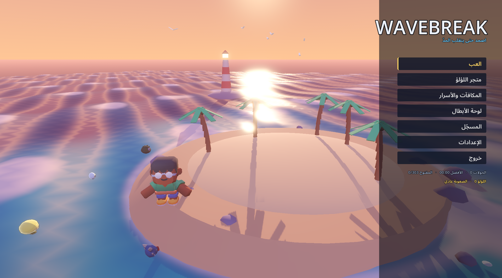 | 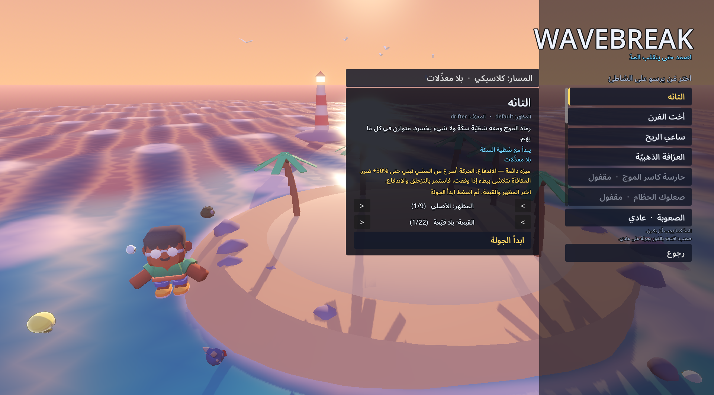 |
| Arabic: title | Arabic: character select |
| 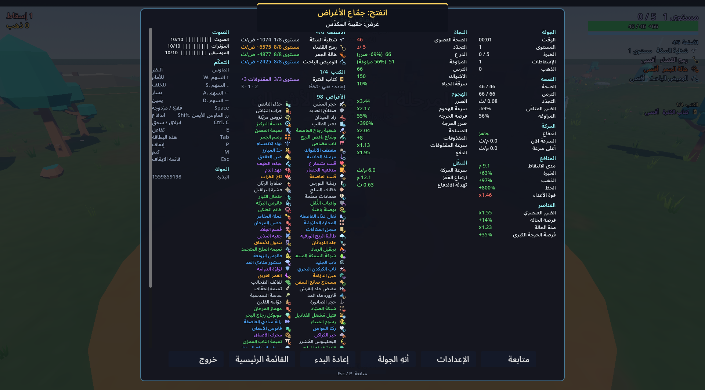 | |
| Arabic: pause sheet | |

## Settings > Gameplay

| Option | What it does |
|---|---|
| Compact level-up | Single-player uses the small docked hand and keeps the game running while you choose (co-op always does) |
| Auto-pick on level up | Off / On: every level-up takes a card at once, and a short note says which |
| Auto-pick rule | Best rarity first, Prefer weapons, Prefer items, Prefer tomes, Upgrade what I have, Random |

## Controls

| Key | Action |
|---|---|
| Mouse | look |
| W A S D | move |
| Space | jump / double jump |
| Shift, right mouse | dash |
| Ctrl | slide; in the air, slam |
| E, left mouse | interact |
| Tab | hold for the big map (fog of war, landmarks, the team, chests, shrines, portal, pings), your stats and your build |
| Y | hold for the scoreboard |
| G, middle mouse | ping the spot you look at (co-op; a local marker in single-player) |
| Esc / P | pause menu (Resume, Settings, End Run, Restart, Main menu, Quit; in co-op, Leave Game instead of End Run and Restart) |
| M, `[` `]`, `-` `=`, `9` `0` | mute, music volume, master volume, effects volume |

A small minimap sits in the top-right corner (north up;
Settings → Graphics → CAMERA & HUD turns it off or changes its size). Each
map starts unexplored: the minimap and the Tab map show only what you (and
your teammates, in co-op) have been near, and enemies, chests and shrines in
the fog stay hidden. On Stormwatch Harbour the name of the district you are
in shows under the minimap.
All keys can be rebound in Settings → Key bindings. The game pauses itself
when its window loses focus.

## Developer panel

**Ctrl+Shift+D**, on the title screen or in a run, opens a hidden
panel. It can unlock everything, give Pearls, edit your build, spawn anything
and jump between stages. A run that uses it does not count toward quests,
stats or the leaderboard. Its Profile tab can also show direct-IP host and
join rows on the CO-OP page, for testing co-op without Steam.

## Building from source

Requirements: Godot 4.7.1 .NET and the .NET 8 SDK.

```bash
dotnet build
Godot_v4.7.1-stable_mono_win64.exe --path .
```

Release and installer:

```bash
Godot_v4.7.1-stable_mono_win64_console.exe --headless --path . --export-release "Windows Desktop" build/windows/Wavebreak.exe
"C:\Program Files (x86)\Inno Setup 6\ISCC.exe" installer/Wavebreak.iss
```

The test flags, self-checks and how the code is organised are in
[ARCHITECTURE.md](ARCHITECTURE.md). Third-party assets and their licences are
in [assets/CREDITS.md](assets/CREDITS.md).
